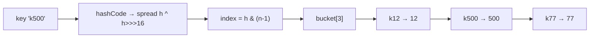

# 4. Implement a HashMap

<span class="level l2">L2</span> ★★★ · Hashing, buckets, chaining, resize, `equals`/`hashCode`

## Problem

> Implement `put`, `get`, `remove` and `size` for a generic hash map without using any `java.util` map.
> Support `null` keys, collisions, and growth beyond the initial capacity.

## Key idea

Keep an **array of buckets**, where each bucket is a linked list of nodes. The key's hash picks the bucket; within the bucket,
`equals` finds the node. When `size > capacity × 0.75`, **double** the table and redistribute the nodes so the chains stay short.
Java 8+ `HashMap` also turns long chains into red-black trees (at 8 nodes). Mention that as a follow-up.



## Solution

```java title="MyHashMap.java"
--8<-- "coding-interview/src/MyHashMap.java"
```

## Walkthrough

| Code | Why |
|---|---|
| `h ^ (h >>> 16)` | The index uses only the low bits. Mixing in the high bits stops hash codes that differ only in their upper bits from all landing in one bucket. This is what `java.util.HashMap.hash()` does. |
| `hash & (length - 1)` | A fast modulo, valid because the capacity is always a power of two. It also never goes negative, unlike `%` on a negative hash. |
| `n.hash == h && Objects.equals(n.key, key)` | Compare the cached hash first (cheap), then `equals`. `Objects.equals` handles the `null` key. |
| `if (++size > table.length * LOAD_FACTOR) resize()` | A 0.75 load factor keeps the average chain length below 1, so `get` stays O(1) on average. |
| `int i = indexFor(n.hash, table.length)` | Resizing reuses the stored hash instead of calling `hashCode()` again, which matters for expensive keys. |
| `record BadKey ... hashCode() { return 42; }` | The test forces every key into one bucket to prove that chaining and `equals` work, and shows why a bad `hashCode` makes lookups O(n). |

## Complexity

| Approach | Time | Space |
|---|---|---|
| get / put / remove (average) | O(1) | O(n) |
| Worst case (all collide, chaining) | O(n) | O(n) |
| Worst case, Java 8 treeified bins | O(log n) | O(n) |
| resize | O(n), amortised O(1) per put | O(n) |

## Run it

```bash
java coding-interview/src/MyHashMap.java      # JDK 21+ single-file launcher, no build needed
```

```text
--8<-- "coding-interview/outputs/MyHashMap.txt"
```

## Common mistakes

* Using `hashCode() % length`. A negative hash gives a negative index. Mask with `& (length - 1)` or use `Math.floorMod`.
* Comparing keys with `==` instead of `equals`.
* Forgetting to update `size` on replace (it shouldn't change) or on remove (it should).
* Mutating a key after inserting it. Its hash changes and the entry is lost. Keys should be immutable.

## Follow-up questions

??? question "Why is the default capacity 16 and the load factor 0.75?"
    Powers of two make the index a bit mask. 0.75 is a time/space trade-off: under a Poisson model, chains longer than 8 are very rare (about 1 in 10 million), which is also why the treeify threshold is 8.

??? question "How does HashMap behave with concurrent writers?"
    It isn't thread-safe. Concurrent `put`s can lose updates, and in JDK 7 a concurrent resize could create a cycle that caused an infinite loop. Use `ConcurrentHashMap` (CAS on empty bins, a `synchronized` lock per bin head, and a cooperative resize).

??? question "What's the difference between HashMap, LinkedHashMap and TreeMap?"
    Hash order with O(1) operations; insertion or access order with O(1) operations and an extra linked list; sorted order with O(log n) operations (a red-black tree, so keys must be `Comparable` or you need a `Comparator`).
