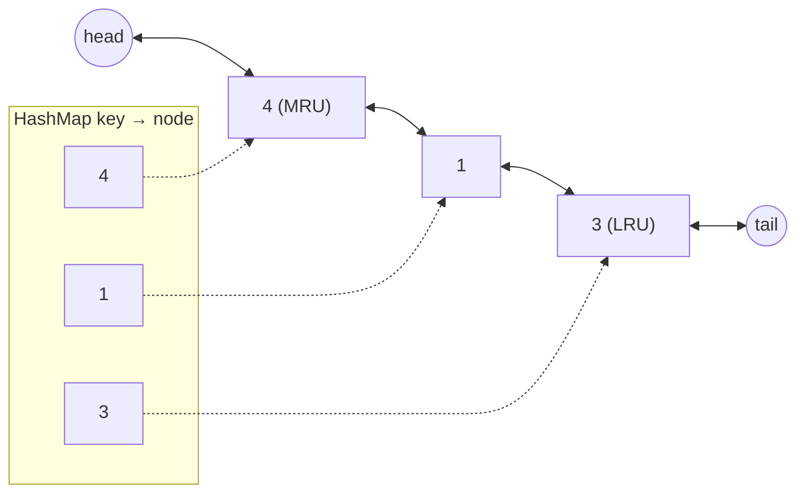

# 5. LRU Cache

<span class="level l2">L2</span> ★★☆ · `HashMap` + doubly linked list, `LinkedHashMap` access order

## Problem

> Design a cache with a fixed capacity where `get(key)` and `put(key, value)` both run in **O(1)**. When the cache is full,
> evict the **least recently used** entry. A `get` counts as a use.

## Key idea

You need two things at once: **O(1) lookup** (a hash map) and **O(1) reordering** (a doubly linked list ordered from most to
least recently used). The map points at list nodes, so you can unlink a node in O(1) and move it to the front.
Sentinel head and tail nodes remove all the null checks at the edges.



## Solution

```java title="LruCache.java"
--8<-- "coding-interview/src/LruCache.java"
```

## Walkthrough

| Code | Why |
|---|---|
| `private final Node head = new Node(), tail = new Node()` | Sentinels: the list is never empty, so `unlink` and `addFirst` need no special cases. |
| `Node lru = tail.prev; unlink(lru); index.remove(lru.key)` | The node stores its key so that eviction can also remove it from the map. A common question is "why store the key in the node?": this is why. |
| `if (n != null) { n.value = value; moveToFront(n); return; }` | Updating an existing key also counts as a use, and it must not grow the size or evict anything. |
| `new LinkedHashMap<>(16, 0.75f, true)` | The third argument `true` switches to **access order**: `get` moves the entry to the end. `removeEldestEntry` is the eviction hook. |

## Complexity

| Approach | Time | Space |
|---|---|---|
| HashMap + DLL | O(1) get/put | O(capacity) |
| LinkedHashMap | O(1) get/put | O(capacity) |

## Run it

```bash
java coding-interview/src/LruCache.java      # JDK 21+ single-file launcher, no build needed
```

```text
--8<-- "coding-interview/outputs/LruCache.txt"
```

## Common mistakes

* Using a singly linked list. Unlinking then needs the predecessor, which makes it O(n).
* Using `ArrayList` or `Deque.remove(Object)` to move an element. That's O(n).
* Forgetting that `get` changes the order. With `LinkedHashMap` you must pass `accessOrder = true`.
* Not making it thread-safe when the question says "shared". Wrap it in a lock, or say you would use Caffeine.

## Follow-up questions

??? question "How would you make it thread-safe?"
    The simplest way is one `ReentrantLock` around get and put, because even `get` mutates the order. For high throughput, use Caffeine: concurrent hash map reads plus buffered, batched reordering (the W-TinyLFU policy).

??? question "LRU vs LFU: when is LFU better?"
    LFU keeps items that are accessed often even if they weren't used recently, so a single scan can't flush the hot set. It's more complex (O(1) LFU uses frequency buckets of linked lists) and needs ageing so that old hot items eventually expire.
