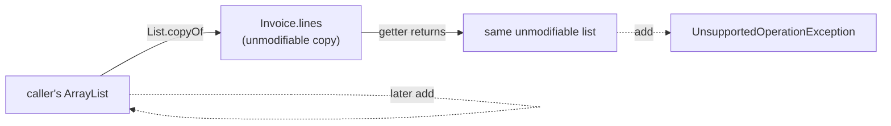

# 6. Immutable Class & the equals/hashCode Contract

<span class="level l2">L2</span> ★★☆ · `final`, defensive copies, records, `HashSet` behaviour

## Problem

> Write an immutable `Invoice(number, totalCents, lines)` class. Show that callers can't change it, add a
> "wither" for updates, and demonstrate what goes wrong when `equals` is overridden without `hashCode`.

## Key idea

An immutable object's state is fixed at construction. The checklist: **final class**, **private final fields**,
**validate in the constructor**, **copy mutable inputs**, **no setters**, **don't leak mutable internals**, and
**implement `equals` + `hashCode` together**. A `record` gives you most of that, but its components are only
*shallowly* immutable, so you still copy lists in the compact constructor.



## Solution

```java title="ImmutableMoney.java"
--8<-- "coding-interview/src/ImmutableMoney.java"
```

## Walkthrough

| Code | Why |
|---|---|
| `static final class Invoice` | `final` stops a subclass from adding mutable state or overriding accessors. |
| `this.lines = List.copyOf(lines)` | Copying protects against the caller changing its list afterwards, and the copy is itself unmodifiable. It also rejects `null` elements. |
| `Invoice withTotal(long newTotal)` | Updates return a **new** object, which makes the class thread-safe without locks. |
| `o instanceof Invoice other && ...` | Pattern matching in `equals`. All the fields used in `equals` must also be used in `hashCode`. |
| `record InvoiceRecord ... { lines = List.copyOf(lines); }` | A record's compact constructor can normalise its parameters. Without this, the record would hold the caller's mutable list. |
| `broken.contains(new BrokenKey("a")) == false` | Equal objects with different (identity) hash codes land in different buckets, so the `HashSet` never even calls `equals`. |

## Complexity

| Approach | Time | Space |
|---|---|---|
| Construction (copy of n lines) | O(n) | O(n) |
| equals / hashCode | O(n) | O(1) |

## Run it

```bash
java coding-interview/src/ImmutableMoney.java      # JDK 21+ single-file launcher, no build needed
```

```text
--8<-- "coding-interview/outputs/ImmutableMoney.txt"
```

## Common mistakes

* Returning the internal `ArrayList` from a getter, which lets callers change it.
* Assigning the constructor's list parameter directly without copying it.
* Overriding `equals` but not `hashCode`. That breaks `HashMap`, `HashSet` and every cache.
* Thinking `final` fields make an object deeply immutable. `final List` stops reassignment, not mutation.

## Follow-up questions

??? question "Why are immutable objects thread-safe?"
    There is no state change to race on. Also, the JMM guarantees that `final` fields are visible to every thread once the constructor finishes (as long as `this` doesn't escape during construction), so no synchronization is needed even for unsafe publication.

??? question "Why is String immutable?"
    Security (paths and class names can't change after they're checked), safe sharing in the string pool, a cached `hashCode` (great for map keys), and thread safety.

??? question "What's the equals/hashCode contract?"
    If two objects are equal, their hash codes must be equal. The reverse isn't required, since collisions are allowed. `equals` must be reflexive, symmetric, transitive and consistent, and `x.equals(null)` must be false.
