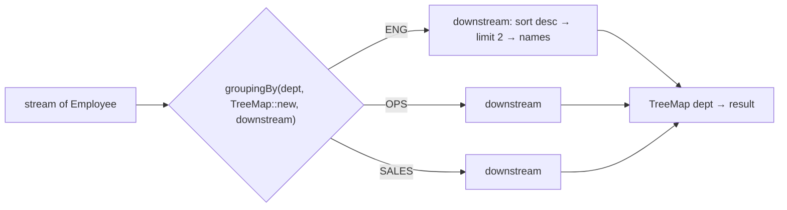

# 7. Streams: Top Earners per Department

<span class="level l2">L2</span> ★★☆ · `groupingBy`, `collectingAndThen`, `maxBy`, `partitioningBy`

## Problem

> Given a list of employees `(name, dept, salary)`, use the Stream API to find: the **top 2 earners per department**,
> the **average salary per department**, the **highest paid** person in each department, and **how many earn above
> a threshold**.

## Key idea

Almost every "report" question is `groupingBy(classifier, mapFactory, downstreamCollector)`. The downstream collector
decides what each group turns into: `counting()`, `averagingLong()`, `maxBy()`, or `collectingAndThen(toList(), ...)`
for anything custom like "sort and take N".



## Solution

```java title="TopEarnersByDepartment.java"
--8<-- "coding-interview/src/TopEarnersByDepartment.java"
```

## Walkthrough

| Code | Why |
|---|---|
| `groupingBy(Employee::dept, TreeMap::new, ...)` | Asking for a `TreeMap` gives sorted, deterministic keys. The default `HashMap` order is unspecified. |
| `collectingAndThen(toList(), list -> ... .limit(n) ...)` | Collect each group, then post-process it. This is the standard way to do top-N per group. |
| `comparingLong(Employee::salary).reversed().thenComparing(Employee::name)` | Descending salary, with ties broken by name so the result is stable. |
| `maxBy(...) returns Optional<Employee>` | `maxBy` gives an `Optional` because a group could in theory be empty. Unwrap it with `collectingAndThen(maxBy(...), Optional::get)` if you prefer. |
| `partitioningBy(pred, counting())` | Always returns **both** `true` and `false` keys, unlike `groupingBy` on a boolean. |

## Complexity

| Approach | Time | Space |
|---|---|---|
| Group + sort per group | O(n log n) | O(n) |
| Average / max per group | O(n) | O(d) departments |

## Run it

```bash
java coding-interview/src/TopEarnersByDepartment.java      # JDK 21+ single-file launcher, no build needed
```

```text
--8<-- "coding-interview/outputs/TopEarnersByDepartment.txt"
```

## Common mistakes

* Sorting the whole stream and then grouping. Order inside the groups isn't guaranteed unless the downstream collector preserves it.
* Using `Collectors.toMap` without a merge function, which throws `IllegalStateException` on duplicate keys.
* Calling `.get()` on `maxBy`'s `Optional` without thinking about empty groups.
* Using `parallelStream()` for small lists. The overhead is bigger than the gain.

## Follow-up questions

??? question "How do you get the second-highest salary overall?"
    `staff.stream().map(Employee::salary).distinct().sorted(Comparator.reverseOrder()).skip(1).findFirst()`. `distinct()` makes it the second-highest *salary* rather than the second employee.

??? question "Group by two levels: department, then salary band."
    Nest the collectors: `groupingBy(Employee::dept, groupingBy(e -> e.salary() > 150 ? "HIGH" : "LOW", counting()))`.

??? question "map vs flatMap?"
    `map` transforms each element 1:1. `flatMap` turns each element into a stream and flattens the results, for example all employees' skills: `flatMap(e -> e.skills().stream())`.
