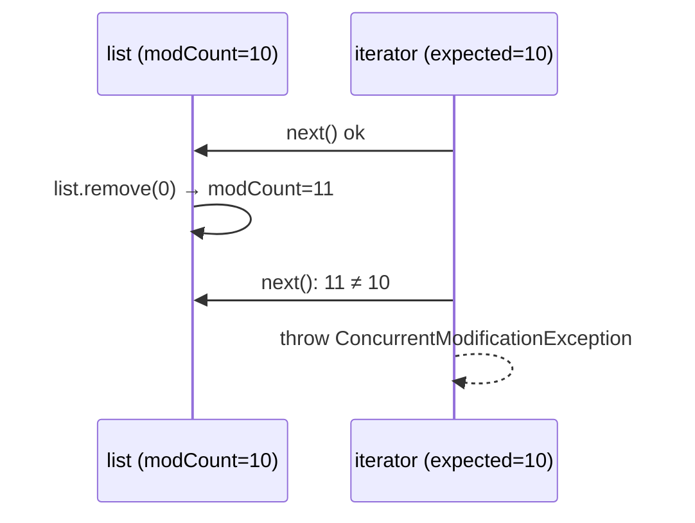

# 8. ArrayList with a Fail-Fast Iterator

<span class="level l2">L2</span> ★★☆ · Array growth, `modCount`, `ConcurrentModificationException`

## Problem

> Implement a growable list (`add`, `get`, `remove`, `size`) with an iterator that **fails fast** when the list is
> structurally modified during iteration, and supports a safe `iterator.remove()`.

## Key idea

Store the elements in an `Object[]` and grow it by about 1.5× when it's full, which makes `add` amortised O(1). A **`modCount`** increases
on every structural change. Each iterator remembers `expectedModCount` when it's created and throws
`ConcurrentModificationException` if the two differ. `iterator.remove()` is legal because it updates
`expectedModCount` itself.



## Solution

```java title="MyArrayList.java"
--8<-- "coding-interview/src/MyArrayList.java"
```

## Walkthrough

| Code | Why |
|---|---|
| `Arrays.copyOf(elements, size + (size >> 1) + 1)` | Growing by 1.5× keeps the total copying cost linear, so each `add` is amortised O(1). Growing by a constant amount would make n adds O(n²). |
| `elements[--size] = null` | Clears the slot after a remove. Without it the array keeps a reference to the removed object, which is a classic memory leak. |
| `Objects.checkIndex(i, size)` | Checks against `size`, not `capacity`. Slots beyond `size` exist but aren't part of the list. |
| `expectedModCount = modCount (in iterator.remove)` | Removing through the iterator re-syncs the counters, so no exception is thrown. |
| `cursor = lastReturned` | After removing, the next element has moved into the removed slot, so the cursor steps back. |

## Complexity

| Approach | Time | Space |
|---|---|---|
| add (amortised) | O(1) | O(n) |
| get | O(1) | - |
| remove(i) | O(n - i) shifting | - |

## Run it

```bash
java coding-interview/src/MyArrayList.java      # JDK 21+ single-file launcher, no build needed
```

```text
--8<-- "coding-interview/outputs/MyArrayList.txt"
```

## Common mistakes

* Removing inside a for-each loop. Use `iterator.remove()` or `list.removeIf(...)`.
* Thinking fail-fast is a concurrency guarantee. It's *best effort* and only meant to catch bugs; it isn't synchronization.
* Forgetting to null out the freed slot after `remove`.

## Follow-up questions

??? question "Fail-fast vs fail-safe iterators?"
    Fail-fast iterators (`ArrayList`, `HashMap`) throw on concurrent modification. Fail-safe or weakly consistent ones (`CopyOnWriteArrayList`, `ConcurrentHashMap`) iterate over a snapshot or tolerate changes and never throw a CME.

??? question "ArrayList vs LinkedList: which, and when?"
    `ArrayList` is almost always the right choice: cache-friendly with O(1) `get`. `LinkedList` only wins for frequent insertion or removal in the middle *through an iterator*, and it uses about 3× the memory per element.

??? question "Why does remove(int) vs remove(Object) cause bugs with List<Integer>?"
    `list.remove(1)` removes **index** 1. Use `list.remove(Integer.valueOf(1))` to remove the value 1.
