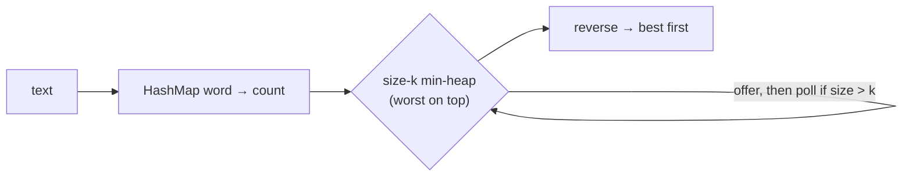

# 9. Top-K Frequent Words

<span class="level l2">L2</span> ★★☆ · `PriorityQueue` min-heap, comparators, tie-breaking

## Problem

> Given a text, return the `k` most frequent words, ignoring case and punctuation. Break ties alphabetically.

## Key idea

First count with a `HashMap`. Then either **sort all distinct words** (simple, O(m log m)) or keep a **min-heap of size k**
whose root is the *worst* of the current top k. Each new word replaces the root only if it's better, which is
O(m log k). The heap wins when k is much smaller than m.



## Solution

```java title="TopKFrequentWords.java"
--8<-- "coding-interview/src/TopKFrequentWords.java"
```

## Walkthrough

| Code | Why |
|---|---|
| `comparingByValue().reversed().thenComparing(comparingByKey())` | "Best first" means higher count first, then A to Z. The explicit type witness `Map.Entry.<String, Long>` helps type inference. |
| `new PriorityQueue<>(BY_FREQ_THEN_ALPHA.reversed())` | The heap must keep the **worst** element on top so it can be evicted. Reversing the order turns the min-heap into "worst first". |
| `if (heap.size() > k) heap.poll()` | Add, then trim. The heap never holds more than k + 1 elements. |
| `split("[^a-z']+")` | Splits on anything that isn't a letter (or apostrophe), so punctuation and multiple spaces are handled in one regex. |

## Complexity

| Approach | Time | Space |
|---|---|---|
| Sort all distinct words | O(n + m log m) | O(m) |
| Min-heap of size k | O(n + m log k) | O(m + k) |
| Bucket sort by count | O(n + m) | O(m) |

## Run it

```bash
java coding-interview/src/TopKFrequentWords.java      # JDK 21+ single-file launcher, no build needed
```

```text
--8<-- "coding-interview/outputs/TopKFrequentWords.txt"
```

## Common mistakes

* Using a max-heap of all m words and polling k times. It works but uses O(m) heap space and is O(m + k log m).
* Getting the tie-break direction wrong inside the reversed heap comparator. Test with ties, as the demo does with dog and fox.
* Forgetting `toLowerCase(Locale.ROOT)`. The default locale breaks some languages, for example the Turkish dotless i.

## Follow-up questions

??? question "The text is a 1 TB log file. What changes?"
    Stream it line by line and count in a map that fits in memory. If it doesn't fit, shard by `hash(word) % N` into N files, compute the top k for each, and merge (the classic MapReduce). For an approximate answer in small memory, use a Count-Min Sketch with a heap.

??? question "Top k over a sliding window of the last 5 minutes?"
    Keep per-minute count maps in a ring buffer. Add new events to the current minute and subtract the expired minute's map from a running total. Recompute the top k from the totals with a heap.
