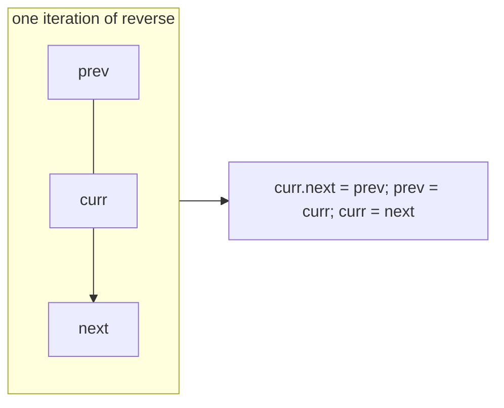
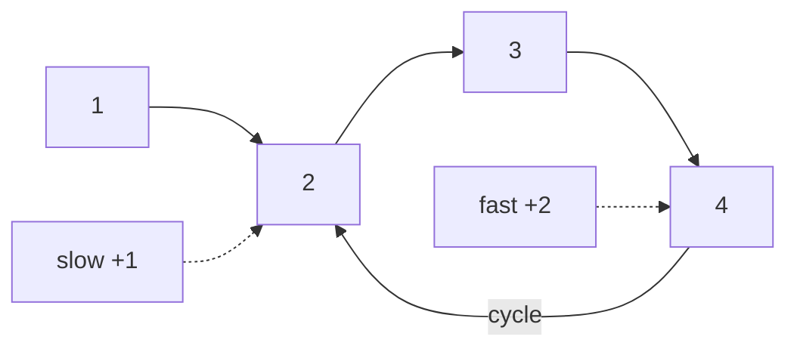

# 10. Linked List: Reverse, Middle, Cycle

<span class="level l1">L1</span> ★★☆ · Pointer manipulation, slow/fast pointers, Floyd's algorithm

## Problem

> For a singly linked list: **reverse** it (iteratively and recursively), find the **middle** node, and **detect a cycle**.

## Key idea

Reversal flips one `next` pointer at a time while you hold on to the rest of the list. **Two pointers** moving at different speeds
solve both of the other problems: when the fast pointer reaches the end, the slow one is in the middle; and if there is a loop,
the fast pointer eventually laps the slow one (Floyd's tortoise and hare).





## Solution

```java title="LinkedListOps.java"
--8<-- "coding-interview/src/LinkedListOps.java"
```

## Walkthrough

| Code | Why |
|---|---|
| `Node next = curr.next; curr.next = prev; prev = curr; curr = next;` | The four lines in this order. Save `next` *before* overwriting `curr.next`, or you lose the rest of the list. |
| `return prev` | When `curr` falls off the end, `prev` is the old tail, which is the new head. |
| `head.next.next = head; head.next = null;` | In the recursive version, make the next node point back at the current one, then cut the forward link to avoid a 2-cycle. |
| `while (fast != null && fast.next != null)` | This guard covers lists of both odd and even length. With an even length, `slow` ends on the second middle. |
| `if (slow == fast) return true` | Compare by reference (`==`), not by value. Two nodes can hold the same value. |

## Complexity

| Approach | Time | Space |
|---|---|---|
| Reverse iterative | O(n) | O(1) |
| Reverse recursive | O(n) | O(n) call stack |
| Middle / Floyd | O(n) | O(1) |

## Run it

```bash
java coding-interview/src/LinkedListOps.java      # JDK 21+ single-file launcher, no build needed
```

```text
--8<-- "coding-interview/outputs/LinkedListOps.txt"
```

## Common mistakes

* Losing the rest of the list by assigning `curr.next = prev` before saving `curr.next`.
* Using recursion on very long lists, which risks `StackOverflowError`. Say so in the interview.
* Detecting a cycle with a `HashSet` of visited nodes. It's correct but uses O(n) space, and interviewers want Floyd.

## Follow-up questions

??? question "Find where the cycle starts."
    After `slow == fast`, move one pointer back to `head`. Advance both one step at a time; they meet at the start of the cycle. (The distance from the head to the start equals the distance from the meeting point to the start, modulo the cycle length.)

??? question "Reverse in groups of k."
    Reverse k nodes with the same three-pointer loop, connect the previous group's tail to the new head, and recurse or iterate on the remainder. Leave a final group shorter than k unchanged if the problem says so.
