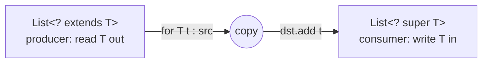

# 11. Generics: Bounded Types & PECS

<span class="level l3">L3</span> ★★★ · `<T extends Comparable<? super T>>`, wildcards, PECS

## Problem

> Write generic `max(collection)`, `copy(dst, src)` and `filter(items, predicate)` methods that accept the widest
> useful range of types. `max` must work for `Apple extends Fruit implements Comparable<Fruit>`.

## Key idea

**PECS: Producer `extends`, Consumer `super`.** A parameter you only **read** from is a producer, so it gets
`? extends T`. A parameter you only **write** to (or pass values into, like a predicate or comparator) is a consumer, so it gets `? super T`.
`T extends Comparable<? super T>` allows types that inherit `compareTo` from a supertype.



## Solution

```java title="GenericsPecs.java"
--8<-- "coding-interview/src/GenericsPecs.java"
```

## Walkthrough

| Code | Why |
|---|---|
| `<T extends Comparable<? super T>> T max(Collection<? extends T> items)` | This is `Collections.max`'s signature. Without `? super T`, `max(List<Apple>)` won't compile, because `Apple` is a `Comparable<Fruit>`, not a `Comparable<Apple>`. |
| `copy(List<? super T> dst, List<? extends T> src)` | One method copies Apples into `List<Apple>`, `List<Fruit>` or `List<Object>`. |
| `Predicate<? super T> keep` | A `Predicate<Object>` (like `Objects::nonNull`) can test Apples. Functional parameters are consumers. |
| `Iterator<? extends T> it` | You can **read** a `T` from a `? extends T` structure, but you can't add to it (apart from `null`). |

## Complexity

| Approach | Time | Space |
|---|---|---|
| max / copy / filter | O(n) | O(1) / O(n) output |

## Run it

```bash
java coding-interview/src/GenericsPecs.java      # JDK 21+ single-file launcher, no build needed
```

```text
--8<-- "coding-interview/outputs/GenericsPecs.txt"
```

## Common mistakes

* Writing `List<Fruit> fruits = apples;`. Generics are **invariant**, so `List<Apple>` isn't a `List<Fruit>`.
* Using `? extends` on a list you need to add to.
* Using raw types (`List list`) to "make it compile". You lose type safety and get heap pollution warnings.

## Follow-up questions

??? question "What is type erasure, and what can't you do because of it?"
    Generic types are checked at compile time and erased to their bounds in bytecode. So you can't write `new T()`, `new T[]`, `instanceof List<String>`, or overload `m(List<String>)` with `m(List<Integer>)`. The workaround is to pass a `Class<T>` or a `Supplier<T>`.

??? question "Why are arrays covariant but generics invariant?"
    Arrays check stores at run time (`ArrayStoreException`), so `Object[] o = new String[1]` compiles but `o[0] = 1` fails at run time. Generics are erased and can't check at run time, so the compiler forbids the unsafe assignment.
