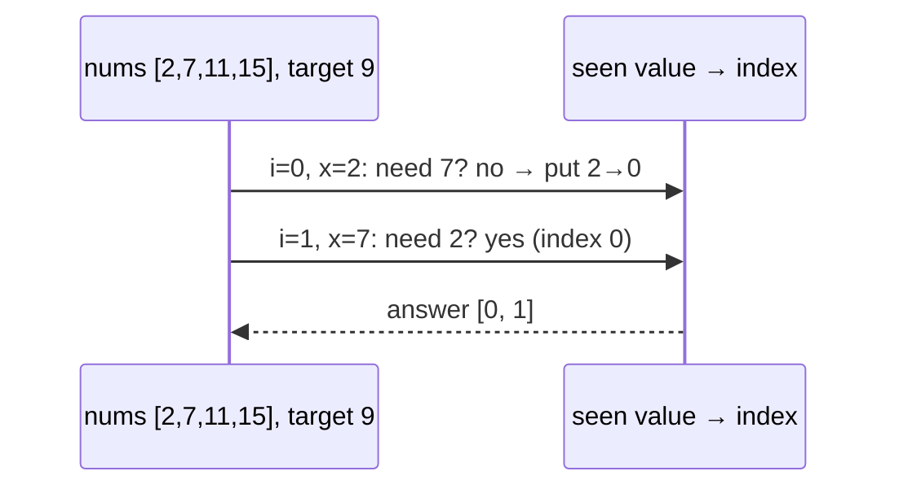

# 12. Two Sum & the HashMap Family

<span class="level l1">L1</span> ★☆☆ · Complement lookup, `Set.add` return value, sliding window

## Problem

> 1. **Two Sum:** return the indices of two numbers that add up to `target`.
> 2. **First duplicate:** return the first value that appears a second time.
> 3. **Longest substring without repeating characters.**

## Key idea

All three replace a nested loop with a **hash lookup**. For Two Sum, ask "have I already seen `target - x`?" The first
duplicate is the first time `Set.add` returns `false`. For the longest substring, use a **sliding window** whose start jumps past the
last occurrence of a repeated character.



## Solution

```java title="TwoSumAndHashing.java"
--8<-- "coding-interview/src/TwoSumAndHashing.java"
```

## Walkthrough

| Code | Why |
|---|---|
| `indexOf.get(target - nums[i]) before indexOf.put(nums[i], i)` | Looking up *before* inserting stops an element pairing with itself, and still handles `[3,3]`. |
| `if (!seen.add(n)) return ...` | `Set.add` returns `false` when the element is already present, so one call does both the check and the insert. |
| `if (prev != null && prev >= start) start = prev + 1` | Only jump if the previous occurrence is **inside** the current window. Otherwise `"abba"` would move the start backwards. |

## Complexity

| Approach | Time | Space |
|---|---|---|
| Two Sum: brute force | O(n²) | O(1) |
| Two Sum: HashMap | O(n) | O(n) |
| Two Sum: sort + two pointers | O(n log n) | O(n) to keep indices |
| Longest unique substring | O(n) | O(alphabet) |

## Run it

```bash
java coding-interview/src/TwoSumAndHashing.java      # JDK 21+ single-file launcher, no build needed
```

```text
--8<-- "coding-interview/outputs/TwoSumAndHashing.txt"
```

## Common mistakes

* Inserting before looking up in Two Sum, which can return `[i, i]`.
* In the sliding window, setting `start = prev + 1` without checking `prev >= start`.
* Returning values when the question asks for indices, or the other way round. Clarify first.

## Follow-up questions

??? question "The array is sorted. Can you do better on space?"
    Yes. Use two pointers, one at each end: if the sum is too small move left forward, if it's too big move right back. That's O(n) time and O(1) space.

??? question "Three Sum (all unique triplets adding to 0)?"
    Sort, then for each `i`, run the two-pointer search on the rest, skipping duplicate values. That's O(n²), which is the expected answer.
