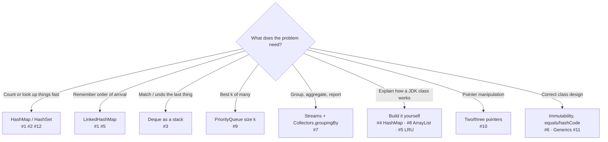

# Coding Interview: 12 Core Java Problems, Explained

These are the core-Java coding questions that come up again and again in service-company, product-company and bank
interviews: strings, hashing, collections internals, streams, generics and linked lists. Every problem has a
**runnable, self-checking solution** in
[`coding-interview/src`](https://github.com/khiruashish/java-playbook/tree/main/coding-interview/src).
Each file ends with assertions and prints `PASS`, and CI runs all of them on every change. The code on each page is
**included from those files**, so what you read is exactly what was compiled and tested.

For multithreading coding problems (thread pools, blocking queues, odd/even printers and more), see the
[Java Multithreading Playbook's Coding Interview tab](https://khiruashish.github.io/java-multithreading-playbook/coding-interview/).

Each page follows the same structure:

1. **Problem**: the statement as an interviewer would give it.
2. **Key idea**: the shape of the solution before any code, with a diagram.
3. **Solution**: the complete, runnable code (included from the repository, so it is exactly what CI ran).
4. **Walkthrough**: the important lines and *why* they are written that way.
5. **Complexity**: time and space for each approach.
6. **Run it**: the command and its real output.
7. **Common mistakes** and **follow-up questions** with answers.

## Problem map

| # | Problem | What it tests | Level | Difficulty |
|---|---|---|---|---|
| 1 | [First Non-Repeating Character](01-first-non-repeating.md) | Counting, `LinkedHashMap`, streams `groupingBy` | <span class="level l1">L1</span> | ★☆☆ |
| 2 | [Group Anagrams](02-group-anagrams.md) | Canonical keys, `computeIfAbsent`, `groupingBy` | <span class="level l1">L1</span> | ★★☆ |
| 3 | [Balanced Brackets](03-balanced-brackets.md) | `ArrayDeque` as a stack | <span class="level l1">L1</span> | ★☆☆ |
| 4 | [Implement a HashMap](04-implement-hashmap.md) | Hashing, buckets, chaining, resize, `equals`/`hashCode` | <span class="level l2">L2</span> | ★★★ |
| 5 | [LRU Cache](05-lru-cache.md) | `HashMap` + doubly linked list, `LinkedHashMap` access order | <span class="level l2">L2</span> | ★★☆ |
| 6 | [Immutable Class & the equals/hashCode Contract](06-immutable-class.md) | `final`, defensive copies, records, `HashSet` behaviour | <span class="level l2">L2</span> | ★★☆ |
| 7 | [Streams: Top Earners per Department](07-streams-grouping.md) | `groupingBy`, `collectingAndThen`, `maxBy`, `partitioningBy` | <span class="level l2">L2</span> | ★★☆ |
| 8 | [ArrayList with a Fail-Fast Iterator](08-arraylist-fail-fast.md) | Array growth, `modCount`, `ConcurrentModificationException` | <span class="level l2">L2</span> | ★★☆ |
| 9 | [Top-K Frequent Words](09-top-k-frequent.md) | `PriorityQueue` min-heap, comparators, tie-breaking | <span class="level l2">L2</span> | ★★☆ |
| 10 | [Linked List: Reverse, Middle, Cycle](10-linked-list.md) | Pointer manipulation, slow/fast pointers, Floyd's algorithm | <span class="level l1">L1</span> | ★★☆ |
| 11 | [Generics: Bounded Types & PECS](11-generics-pecs.md) | `<T extends Comparable<? super T>>`, wildcards, PECS | <span class="level l3">L3</span> | ★★★ |
| 12 | [Two Sum & the HashMap Family](12-two-sum-hashing.md) | Complement lookup, `Set.add` return value, sliding window | <span class="level l1">L1</span> | ★☆☆ |

Levels: <span class="level l1">L1</span> 0–2 yrs · <span class="level l2">L2</span> 2–5 yrs · <span class="level l3">L3</span> 5–10 yrs · <span class="level l4">L4</span> 10+ yrs / architect.

## Which technique fits? (the interviewer's hidden question)



## How to answer a coding round

1. **Clarify** inputs, outputs, sizes and edge cases (empty, duplicates, nulls, concurrency) *before* coding.
2. **Say the brute force** and its complexity, then the better idea. Interviewers reward the reasoning, not just the answer.
3. **Code the core** with clear names. Leave logging and validation helpers for later.
4. **Test out loud** with a normal case, an edge case and a failure case. Every solution here ends with exactly those checks.
5. **Discuss trade-offs and follow-ups**: scale, thread safety, memory, and what you would do in production.

## Run every solution

```bash
coding-interview/run-all.sh          # runs all 12, writes outputs/
coding-interview/run-all.sh --check  # what CI runs: fails on any failure or changed output
```
